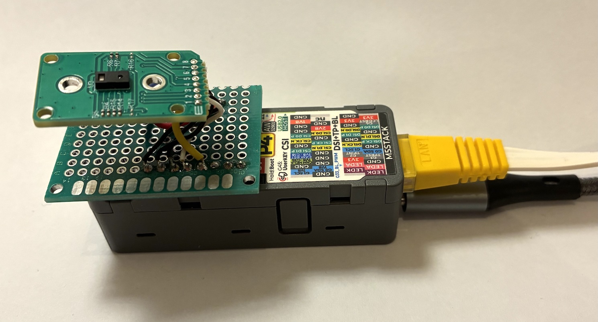
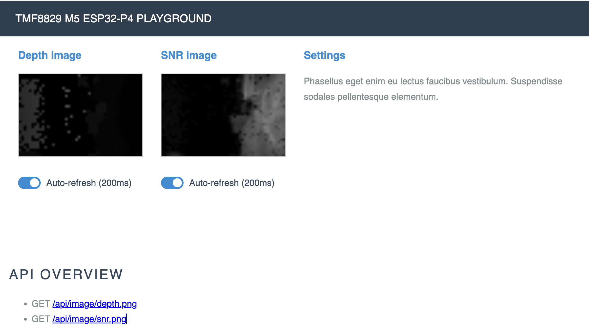

# TMF8829 SPI Driver & Playground (ESP32-P4)

This project provides an ESP-IDF firmware for the **ams OSRAM TMF8829** multi-zone direct Time-of-Flight (dToF) optical distance sensor running on an **ESP32-P4** (e.g., M5Stack Unit PoE-P4).

The core driver was ported from the official ams OSRAM Arduino reference driver (`TMF8829_Driver_Arduino_v1.2.5`)
This application uses high-speed SPI (20MHz) communication (with DMA), and FreeRTOS task yielding for watchdog safety.
It offers a self-contained web-application, for quick and easy visualization of the sensor data.

#### Hardware used

* M5Stack Unit PoE-P4, see https://docs.m5stack.com/en/unit/Unit_PoE-P4 (ca. 25 EUR)
* LightRanger 14 Click, see https://www.mikroe.com/lightranger-14-click (ca. 25 EUR)



---

## Hardware Wiring

The default firmware configuration matches the soldered module pinout. \
You can change the wiring by running `idf.py menuconfig`.

| Signal   | ESP32-P4 GPIO | LightRanger 14 Click | Description                 |
|:---------|:--------------|:---------------------|:----------------------------|
| **MOSI** | `GPIO13`      | pin 6 - SO           | SPI Master Out / Slave In   |
| **SCLK** | `GPIO12`      | pin 5 - CLK          | SPI Clock                   |
| **MISO** | `GPIO11`      | pin 4 - SOO          | SPI Master In / Slave Out   |
| **CS**   | `GPIO10`      | pin 3 - CS           | SPI Chip Select             |
| **DE**   | `GPIO9`       | pin 1 - EN           | Device Enable (active high) |
| **GND**  | `GND`         | pin 8 - GND          | Ground                      |
| **3V3**  | `3.3V`        | pin 7 - VCC          | Power Supply                |

---

## Configuration & Defaults

#### Pre-requisites

This project uses ESP-IDF v5.4.3, because the M5 Unit uses an older chip revision: v1.3.
Newer versions of ESP-IDF require a new chip version - and may require adjustments to ensure compatibility with the M5 Unit.

Typically, you can use EIM (ESP-IDF Installation Manager) to install the required version of ESP-IDF.
And then run `source ~/.espressif/tools/activate_idf_v5.4.3.sh` to activate the environment.

#### Project Configuration

Project defaults in `sdkconfig.defaults.esp32p4` include:
- **Flash Size**: 16 MB (`CONFIG_ESPTOOLPY_FLASHSIZE_16MB=y`)
- **Console Interface**: Native USB Serial/JTAG controller as primary console (`CONFIG_ESP_CONSOLE_USB_SERIAL_JTAG=y`)
- **Main Task Stack Size**: 8 KB (`CONFIG_ESP_MAIN_TASK_STACK_SIZE=8192`)
- **SPI DMA**: Auto DMA channel enabled with max transfer size up to 4 KB to support 500-byte FIFO firmware chunks and raw result frames

Project options can be further adjusted using `menuconfig`:

1. Set target (if not already set):
   ```bash
   idf.py set-target esp32p4
   ```

2. Open the configuration menu:
   ```bash
   idf.py menuconfig
   ```

3. In `TMF8829 Configuration` (or project configuration), adjust:
   - **SPI Host**: default `2` (`SPI2_HOST`)
   - **SPI Clock**: default `20000000` Hz (20 MHz)
   - **Pin Mapping**: `MOSI` (13), `MISO` (11), `SCLK` (12), `CS` (10), `DE` (9)

---

## Build, Flash, and Monitor

Make sure your ESP-IDF environment is active (e.g., `source ~/.espressif/tools/activate_idf_v5.4.3.sh`), then build, flash, and open the serial monitor:

```bash
idf.py -p <PORT> flash monitor
```

*(Replace `<PORT>` with your serial device port, e.g., `/dev/ttyACM0` or `/dev/cu.usbmodem...`)*

To exit the monitor, use the shortcut `Ctrl + ]`.

---

## Web Server

The application provides a web server on port 80, which can be accessed via `http://<ESP32-P4_IP>`.



## UPNP broadcastin service announcement

By default, a UPNP NOTIFY message is broadcasted to announce the device availability.
The message includes the device name, device number, and MAC address.
 
Example

```text
NOTIFY * HTTP/1.1
HOST: 239.255.255.250:1900
CACHE-CONTROL: max-age=1800
LOCATION: http://10.1.2.3:80/description.xml
NT: urn:de-bitkings:device:esp32-p4-tmf8829:1
NTS: ssdp:alive
USN: uuid:12345678-9012-0000-0000-123456789012::urn:de-bitkings:device:esp32-p4-tmf8829:1
```

Whereas the `123456789012` is the MAC address / device serial number of the ESP32-P4 device.

Additionally, when fetching the `/description.xml` this information is returned

```xml
<root xmlns="urn:schemas-upnp-org:device-1-0">
    <specVersion>
        <major>1</major>
        <minor>0</minor>
    </specVersion>
    <device>
        <deviceType>urn:de-bitkings:device:esp32-p4-tmf8829:1</deviceType>
        <friendlyName>esp32-p4-tmf8829</friendlyName>
        <manufacturer>Nitram509</manufacturer>
        <modelName>TMF8829</modelName>
        <modelNumber>TMF8829</modelNumber>
        <serialNumber>0x004D4674</serialNumber>
        <UDN>uuid:80f1b2d1-49eb-0000-0000-80f1b2d149eb</UDN>
        <presentationURL>/</presentationURL>
    </device>
</root>
```

---

## Interactive Serial Console

The application provides an interactive command-line interface via the monitor console. Simply press any of the following keys:

|       Key       | Action                        | Description                                                                           |
|:---------------:|:------------------------------|:--------------------------------------------------------------------------------------|
|       `h`       | **Help**                      | Prints the list of available commands                                                 |
|       `e`       | **Enable & Download FW**      | Enables the sensor via `DE`, powers up, and downloads RAM firmware                    |
|       `m`       | **Measure**                   | Starts continuous distance measurements                                               |
|       `s`       | **Stop**                      | Stops continuous measurement                                                          |
|    `c` / `p`    | **Next Configuration**        | Cycles through optical configurations (8x8, 16x16, 32x32, 48x32, high accuracy, etc.) |
|       `u`       | **Get Configuration**         | Reads and displays current configuration registers                                    |
| `1` / `o` / `O` | **Single-Shot 48x32 Capture** | Captures a 48x32 frame (dual sub-frames) and transmits PGM image via UDP              |
|       `a`       | **Dump Registers**            | Dumps 256 sensor registers over SPI (when stopped)                                    |
|       `w`       | **Wakeup**                    | Wakes up sensor from power-down state                                                 |
|       `P`       | **Power Down**                | Puts sensor into power-down (standby) state                                           |
|       `d`       | **Disable**                   | Drives `DE` low to disable the sensor                                                 |
|       `z`       | **Histogram**                 | Toggles histogram readout / dumping                                                   |
|       `x`       | **Clock Correction**          | Toggles distance clock correction on/off                                              |
|       `+`       | **Log Level +**               | Increases logging verbosity                                                           |
|       `-`       | **Log Level -**               | Decreases logging verbosity                                                           |
|       `#`       | **Reset**                     | Tests software reset on the sensor                                                    |
|       `b`       | **Binary Mode**               | Enters binary command input mode                                                      |

### Typical Usage Walkthroughs

#### 1. Continuous Distance Measurement
1. Open `idf.py monitor`.
2. Press `e` to enable the sensor and download the RAM firmware image. The console will report `CPU ready` and confirm `state=stopped`.
3. (Optional) Press `c` or `p` to select your preferred optical profile (e.g., 8x8 Default, 8x8 Long Range, 16x16, 32x32, 48x32).
4. Press `m` to start measuring. Measurement frames stream to the console.
5. Press `s` to stop measurement at any time.

#### 2. Single-Shot 48x32 Capture & PGM Image Export
1. Press `e` (or wait 5 seconds after startup/reset for auto-enable) to ensure the device is initialized.
2. Trigger a single-shot capture at any time by pressing `1` (or `o` / `O`).
3. The firmware configures 48x32 mode, captures both Sub-frame 0 (even rows) and Sub-frame 1 (odd rows), and decodes the complete 1536-pixel depth map.
4. The complete ASCII PGM image is transmitted as UDP packets to the configured target host and port.
5. Received UDP packets can be captured or saved into a `.pgm` file and viewed in standard image viewers (GIMP, ImageMagick, VS Code PGM viewer).

---

## Compiling the Protocol Buffers source

This project used NanoBP https://github.com/nanopb/nanopb for Protocol Buffers (a.k.a. ProtoBuf) with small code size.

### Prerequisite

Install protoc and nanopb extension
This only needs to be done once.

```shell
brew install protoc
brew install nanopb
```

### Compile the `.proto` file

This uses the regular protoc compiler with nanopb extension to generate the lightweight stubs.

```shell
cd src/protobuf
protoc --proto_path=../../proto --nanopb_out="$(pwd)" message.proto 
```

---

## Project Structure

- `src/main.cpp`: Application entry point (`app_main`), orchestrating the program flow and main task loop.
- `src/app.cpp` & `src/app.h`: High-level application logic, state machine, asynchronous continuous measurement orchestration, and interactive command parser.
- `src/image_pgm.cpp` & `src/image_pgm.h`: Background measurement streaming decoder, thread-safe depth map buffer management, ASCII PGM (P2) exporter, and single-shot capture routines.
- `src/image_png.cpp` & `src/image_png.h`: 16-bit grayscale PNG encoder (using standard non-compressed DEFLATE / zlib container with no external dependencies).
- `src/help.cpp` & `src/help.h`: Helper functions for human-readable mode names, pre-configuration labels, and optical profile descriptions.
- `src/net.cpp` & `src/net.h`: Ethernet driver initialization (ESP32-P4 EMAC + IP101 PHY) and network event handling.
- `src/net_handler.cpp` & `src/net_handler.h`: UDP server listener and Protobuf request handler (`Request` / `GetDeviceInfo` -> `DeviceInfo` response).
- `src/web_server.cpp` & `src/web_server.h`: Embedded HTTP web server (`esp_http_server`) serving `/`, `/index.html`, `/pure-min.css`, `/grids-responsive-min.css`, `/styles.css`, `/api/config` (GET sensor configuration / POST mode updates), `/api/telemetry` (GET real-time diagnostics: on-chip temperatures T0/T1/T2, live FPS, active resolution, frame count), `/api/info` (GET hardware identifiers: Sensor Chip Version, Sensor Serial Number, ESP32 Serial Number / MAC), `/api/image/depth.png` (instant < 2ms snapshot of latest 16-bit PNG depth map), and `/api/image/snr.png` (instant 8-bit PNG signal-to-noise ratio map from background stream).
- `src/web/`: Web static assets embedded directly via ESP-IDF `EMBED_TXTFILES` (`index.html`, `pure-min.css`, `grids-responsive-min.css`, `styles.css`).
- `src/protobuf/`: Protocol Buffers definitions and auto-generated Nanopb bindings (`message.pb.c`, `message.pb.h`).
- `src/vendor/nanopb-0.4.9.2/`: Nanopb protocol buffers library (`pb.h`, `pb_common.c`, `pb_encode.c`, `pb_decode.c`).
- `src/tmf8829/`: Dedicated subsystem for TMF8829 sensor communication, control, and data acquisition:
  - `tmf8829_shim.cpp` & `tmf8829_shim.h`: ESP-IDF hardware shim layer (SPI bus with DMA, GPIO for `DE`, USB Serial/JTAG polling, FreeRTOS yields).
  - `tmf8829.c` & `tmf8829.h`: Core ams OSRAM driver implementing SPI protocol framing, bootloader control, firmware download, and result parsing.
  - `tmf8829_firmware.c` & `tmf8829_firmware.h`: Pre-compiled firmware hex image loaded into TMF8829 RAM during initialization.
- `documentation/`: Sensor datasheet (`DS001140`), communication protocol application note (`AN001096`), and the original Arduino reference implementation.
